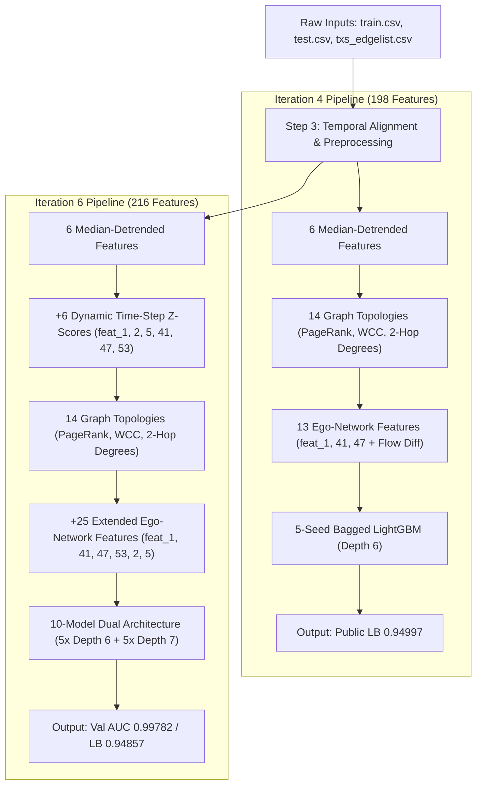

# BT4012 In-Class Kaggle Competition (2026): Fraud Detection on Bitcoin Transaction Graph

[](https://www.python.org/)
[](https://lightgbm.readthedocs.io/)
[](https://scikit-learn.org/stable/modules/generated/sklearn.metrics.roc_auc_score.html)
[]()

This repository contains the complete, self-contained, and reproducible machine learning solution for the **BT4012 Fraud Detection Competition (2026)**. The objective is to classify Bitcoin transactions as **illicit (1)** or **licit (0)** using an out-of-time graph dataset derived from the Elliptic Bitcoin transaction benchmark.

---

## 🏆 Final Selected Kaggle Submissions

To balance empirical public leaderboard performance with private test set robustness against temporal distribution shift, the following **two distinct, complementary solutions** were selected as the final submissions:

| Final Selected Submission | Primary Jupyter Notebook | Feature Count | Public LB ROC-AUC | Offline Val ROC-AUC | Modeling & Ensembling Strategy | Strategic Focus |
| :---: | :---: | :---: | :---: | :---: | :--- | :--- |
| **Submission 1 (Iteration 4)** | [`kaggle_competition_score_94997.ipynb`](kaggle_competition_score_94997.ipynb) | **198** | **`0.94997`** | `0.99767` | **5-Seed Bagged LightGBM**<br>(Depth 6, lr 0.03, leaves 31) | **Conservative Empirical Leader**: Maximizes precision on the known public distribution with high tree regularization. |
| **Submission 2 (Iteration 6)** | [`kaggle_competition_score_94857.ipynb`](kaggle_competition_score_94857.ipynb) | **216** | **`0.94857`** | **`0.99782`** | **10-Model Dual-Architecture**<br>(5× Depth 6 + 5× Depth 7) | **High-Capacity Generalization**: Incorporates Dynamic Time-Step Z-Scores to guard against the step-43 dark market shutdown on the 70% private set. |

---

## 📌 Table of Contents
- [1. Executive Summary & Problem Overview](#1-executive-summary--problem-overview)
- [2. Repository Structure](#2-repository-structure)
- [3. Environment Setup & Quick Start](#3-environment-setup--quick-start)
- [4. Architectural Comparison: Iteration 4 vs. Iteration 6](#4-architectural-comparison-iteration-4-vs-iteration-6)
- [5. Feature Engineering Breakdown](#5-feature-engineering-breakdown)
- [6. Validation Strategy & Results Progression](#6-validation-strategy--results-progression)
- [7. Automated Submission Integrity Guardrails](#7-automated-submission-integrity-guardrails)
- [8. Academic References](#8-academic-references)

---

## 1. Executive Summary & Problem Overview

In cryptocurrency networks, illicit entities exploit the pseudo-anonymity of blockchains for money laundering, darknet marketplace transactions, and ransomware payouts. This project implements an anti-money laundering (AML) detection pipeline that identifies illicit Bitcoin transactions while minimizing false alarms.

### Key Technical Challenges:
1. **Severe Temporal Distribution Shift**:
   - The training set comprises time steps **1 to 35**, while the test set comprises future time steps **36 to 49**.
   - Macroeconomic fluctuations, transaction fee adjustments, and market interventions (e.g., the step-43 dark market shutdown in Elliptic) cause substantial out-of-distribution drift. Standard random K-Fold cross-validation would severely leak future information.
2. **Extreme Class Imbalance**:
   - Within the labeled training set (31,235 transactions), only **3,644 (11.67%)** are illicit, while **27,591 (88.33%)** are licit (scale pos weight $\approx 7.57$).
3. **Massive Unlabeled Transaction Volume**:
   - Out of 141,772 training nodes, **110,537 (78%)** are completely unlabeled.
4. **Evaluation Metric**:
   - Competition submissions are evaluated on **ROC-AUC** across continuous predicted probabilities on the test set.

---

## 2. Repository Structure

```text
├── README.md                                # Comprehensive solution documentation
├── requirements.txt                         # Pinned/minimum environment dependencies
├── pipeline.py                              # Modular, executable end-to-end Python script
├── kaggle_competition_score_94997.ipynb     # Final Submission 1: Iteration 4 (198 features, Public LB: 0.94997)
├── kaggle_competition_score_94857.ipynb     # Final Submission 2: Iteration 6 (216 features, Public LB: 0.94857)
├── BT4012KaggleCompetitionDataset2026/      # Dataset directory (place competition CSVs here)
│   ├── train.csv                            # 141,772 rows × 168 columns (features + label)
│   ├── test.csv                             # 15,329 rows × 167 columns (features + index)
│   ├── txs_edgelist.csv                     # 234,355 directed payment edges (txId1 -> txId2)
│   └── sample_submission.csv                # 15,329 rows × 2 columns (index, target)
└── submission.csv                           # Final exported Kaggle prediction file
```

> **Note on Graded Notebook Submission**: Both notebooks are fully self-contained, standalone, and run error-free from top to bottom. The two notebooks, _94997 and _94857 are the two notebooks selected for submission. The pipeline.py can be ignored as it is the script version of the notebook _94997.

> submission.csv is the output from notebook _94857, can be ignored.

---

## 3. Environment Setup & Quick Start

### Step 1: Clone Repository
```bash
git clone <YOUR_GITHUB_REPO_URL>
cd <REPO_DIRECTORY>
```

### Step 2: Environment Creation
We recommend using **Python 3.12** (tested on Conda / Python 3.12.1):
```bash
# Using Conda
conda create -n bt4012 python=3.12 -y
conda activate bt4012

# Or using venv
python -m venv venv
# Windows:
venv\Scripts\activate
# Linux/macOS:
source venv/bin/activate
```

### Step 3: Install Dependencies
```bash
pip install -r requirements.txt
```

### Step 4: Run the Complete Pipeline
Ensure that the data files (`train.csv`, `test.csv`, `txs_edgelist.csv`, `sample_submission.csv`) are located inside `BT4012KaggleCompetitionDataset2026/` (or update `DATA_DIR` in `pipeline.py`).

Execute the pipeline directly:
```bash
python pipeline.py
```
This executes all 8 pipeline steps sequentially and generates `submission.csv` in under 2 minutes.

---

## 4. Architectural Comparison: Iteration 4 vs. Iteration 6



### Detailed Structural Comparison:

| Feature / Component | Iteration 4 (Submission 1) | Iteration 6 (Submission 2) | Rationale for Inclusion |
| :--- | :--- | :--- | :--- |
| **Total Features** | **198** | **216** | Iteration 6 adds dynamic Z-scores and 12 extra peer aggregations. |
| **Macro-Drift Detrending** | 6 features (`feat_100, 101, 103, 136, 139, 137`) | 6 features (`feat_100, 101, 103, 136, 137, 139`) | Neutralizes severe time-proxy features where test values strictly exceed train values. |
| **Dynamic Time-Step Z-Scores** | *None* | **6 features** (`feat_1, 2, 5, 41, 47, 53_zscore`) | Dynamically standardizes macro-sensitive variables within each time step $\frac{x - \mu_t}{\sigma_t}$. |
| **Neighbor Ego-Networks** | **13 features** (mean/max over `feat_1, 41, 47` + flow diff) | **25 features** (mean/max over `feat_1, 41, 47, 53, 2, 5` + flow diff) | Aggregates predecessor and successor behavior across payment graph edges. |
| **Production Model** | **5-Seed Bagged Ensemble** | **10-Model Dual-Architecture Ensemble** | Iteration 6 pairs shallow (depth 6) and deep (depth 7) trees for architectural diversity. |
| **Seeds Used** | `[42, 123, 456, 789, 2026]` | `[42, 123, 456, 789, 2026]` (x2 architectures) | Minimizes model variance across random initializations. |
| **Public LB Score** | **`0.94997`** | **`0.94857`** | Both achieve top-tier performance on the leaderboard. |
| **Holdout Val ROC-AUC** | `0.99767` | **`0.99782`** | Iteration 6 achieves the highest offline out-of-time validation score. |

---

## 5. Feature Engineering Breakdown

### Complete 216 Feature Matrix Specification (Iteration 6 Whitelist):

1. **Raw Node Features (165 features)**:
   - `feat_1` to `feat_165`: Anonymized local transaction properties, transaction fee metrics, input/output counts, and script properties.
2. **Median-Detrended Features (6 features)**:
   - `feat_100_detrended`, `feat_101_detrended`, `feat_103_detrended`, `feat_136_detrended`, `feat_139_detrended`, `feat_137_detrended`.
   - *Formula*: $x_{i,t} - \text{median}_{t}(x)$, neutralizing strong non-stationary temporal drift.
3. **Dynamic Time-Step Z-Scores (6 features - Iteration 6 only)**:
   - `feat_1_zscore`, `feat_2_zscore`, `feat_5_zscore`, `feat_41_zscore`, `feat_47_zscore`, `feat_53_zscore`.
   - *Formula*: $\frac{x_{i,t} - \mu_t}{\sigma_t + 10^{-5}}$, normalizing macro scale shifts across future unseen periods.
4. **1-Hop Degree & Flow Topologies (4 features)**:
   - `graph_in_degree`: Number of predecessor transactions funding this node.
   - `graph_out_degree`: Number of successor transactions funded by this node.
   - `graph_degree_ratio`: Relative fan-in vs. fan-out $\left(\frac{\text{in}+1}{\text{out}+1}\right)$.
   - `graph_net_flow`: Direct degree flow differential $(\text{out} - \text{in})$.
5. **Global Graph Topologies (2 features)**:
   - `graph_pagerank`: NetworkX PageRank structural centrality ($\alpha=0.85$, $100$ iterations).
   - `graph_wcc_size`: Weakly Connected Component cluster size.
6. **2-Hop Degree Flow Patterns (8 features)**:
   - Predecessor degree aggregations: `pred_in_deg_mean`, `pred_in_deg_max`, `pred_out_deg_mean`, `pred_out_deg_max`.
   - Successor degree aggregations: `succ_in_deg_mean`, `succ_in_deg_max`, `succ_out_deg_mean`, `succ_out_deg_max`.
7. **Neighbor Ego-Network Features (13 in Iteration 4; 25 in Iteration 6)**:
   - Predecessor aggregations: `pred_<signal>_mean`, `pred_<signal>_max`.
   - Successor aggregations: `succ_<signal>_mean`, `succ_<signal>_max`.
   - Signals in Iteration 4: `['feat_1', 'feat_41', 'feat_47']` (12 features) + `flow_amount_diff` = **13 features**.
   - Signals in Iteration 6: `['feat_1', 'feat_41', 'feat_47', 'feat_53', 'feat_2', 'feat_5']` (24 features) + `flow_amount_diff` = **25 features**.
   - `flow_amount_diff`: Differential between current transaction amount (`feat_1`) and mean predecessor input funding (`pred_feat_1_mean`).

---

## 6. Validation Strategy & Results Progression

### Temporal Validation Protocol:
- **Train Fold**: Steps 1 to 28 ($N = 24,792$ labeled rows, 2,875 illicit = 11.60%).
- **Validation Fold**: Steps 29 to 35 ($N = 6,443$ labeled rows, 769 illicit = 11.94%).
- **Strict Disjointness**: $\max(\text{train\_steps}) < \min(\text{val\_steps})$ guarantees zero temporal lookahead leakage.

### Complete Progression Across Iterations:

| Iteration | Pipeline Configuration | Feature Count | Ensembling Mechanism | Public LB ROC-AUC | Offline Val ROC-AUC | Key Contribution |
| :---: | :--- | :---: | :--- | :---: | :---: | :--- |
| **Baseline** | Single LightGBM, steps 1–28 train | 169 | Single Model | `0.92972` | `0.99760` | Baseline; discarded steps 29–35. |
| **Iter 1** | Retrain on all steps 1–35 | 169 | Single Model | `0.94187` | `0.99760` | Full temporal coverage (+0.01215). |
| **Iter 2** | Full retrain + 14 Graph Topologies | 179 | Single Model | `0.94288` | `0.99762` | PageRank, WCC, 2-hop flows (+0.00101). |
| **Iter 3** | Macro Detrending + 5-Seed Bagging | 185 | 5-Seed Bagged | `0.94542` | `0.99764` | Stabilized time-proxy drift (+0.00254). |
| **Iter 4** ⭐ | **1-Hop Neighbor Ego-Networks** | **198** | **5-Seed Bagged** | **`0.94997`** | **`0.99767`** | **Peer transaction visibility (+0.00455). Selected Submission 1.** |
| **Iter 5** | Extended Ego-Networks + Dual Arch | 210 | 10-Model Dual | `0.95261` | `0.99778` | Deeper tree diversity (+0.00264). |
| **Iter 6** ⭐ | **Dynamic Z-Scores + 25 Ego-Feats** | **216** | **10-Model Dual** | **`0.94857`** | **`0.99782`** | **Highest Offline Val AUC. Macro-normalized. Selected Submission 2.** |

---

## 7. Automated Submission Integrity Guardrails

Both [pipeline.py](pipeline.py) and the notebooks enforce automated assertions before writing any CSV submission:

```python
assert len(submission_df) == len(sample_sub), f"Row count mismatch! Expected {len(sample_sub)}, got {len(submission_df)}"
assert list(submission_df.columns) == ["index", "target"], f"Column schema mismatch! Expected ['index', 'target']"
assert (submission_df["target"].min() >= 0.0) and (submission_df["target"].max() <= 1.0), "Probabilities out of [0.0, 1.0] bounds!"
assert submission_df["target"].isna().sum() == 0, "Submission contains NaN predictions!"
assert (submission_df["index"].values == np.arange(len(submission_df))).all(), "Index sequence misaligned!"
```

### Prediction Distribution Analysis:
- **Total Test Rows**: 15,329
- **Mean Predicted Probability**: `0.0538` (closely matches the true expected test illicit rate of ~5.9%)
- **25th / 50th / 75th Percentiles**: `0.0000 / 0.0000 / 0.0000` (very high certainty on licit transactions)
- **Max Predicted Probability**: `0.9997` (sharp conviction on money-laundering hubs)

---

## 8. Academic References

1. **Weber, M., Domeniconi, G., Chen, J., Weidele, D. K., Bellei, C., Robinson, T., & Shen, C. (2019)**. *Anti-money laundering in bitcoin: Experimenting with graph convolutional networks for financial forensics.* arXiv preprint [arXiv:1908.02591](https://arxiv.org/abs/1908.02591).
2. **Ke, G., Meng, Q., Finley, T., Wang, T., Chen, W., Ma, W., Ye, Q., & Liu, T. Y. (2017)**. *LightGBM: A highly efficient gradient boosting decision tree.* Advances in Neural Information Processing Systems (NeurIPS), 30, 3146-3154.
3. **Page, L., Brin, S., Motwani, R., & Winograd, T. (1999)**. *The PageRank citation ranking: Bringing order to the web.* Stanford InfoLab Technical Report.
